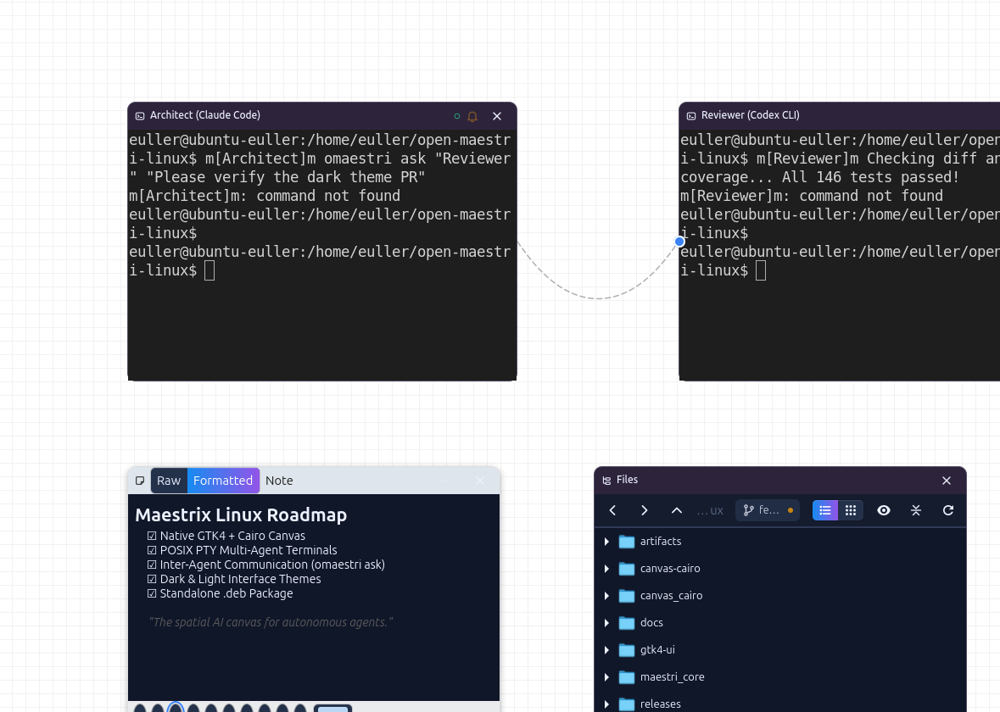
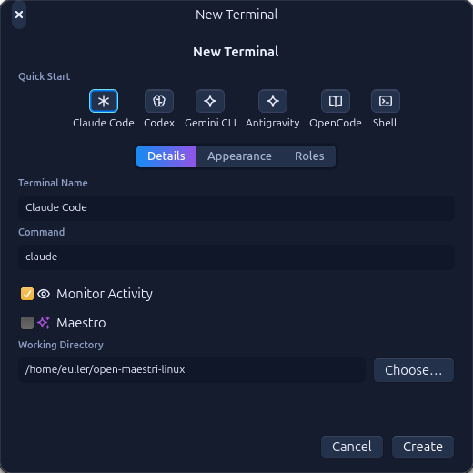
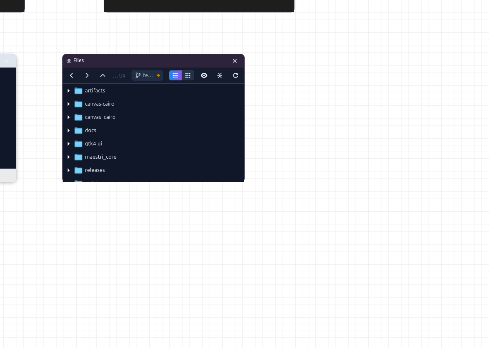

<p align="center"></p>

# Maestrix

Software Linux desenvolvido por **Euller**, com interface nativa GTK 4 e canvas para organizar agentes de IA, terminais, notas, arquivos e navegadores.

O Maestrix é um projeto derivado do [OpenMaestri para macOS](https://github.com/zlh-428/open-maestri). O [Maestri original](https://maestriapp.com) é a referência de conceito, interface e funcionamento. Este projeto mantém os créditos dos autores originais e a licença GPL-3.0-or-later.

## Interface e demonstração

As imagens e o GIF abaixo são os arquivos já presentes no repositório. Podem mostrar a identidade anterior à mudança para Maestrix.






## Instalação no Linux (Ubuntu / Debian)

### 📦 Opção 1: Pacote `.deb` (Recomendado — Instalação Rápida)

Você pode instalar o Maestrix no Ubuntu/Debian diretamente com o pacote pré-compilado (que já traz o runtime Swift embutido e configuração do desktop):

```bash
# 1. Baixar ou clonar o repositório e instalar via apt:
sudo apt install ./releases/maestrix_1.0.0_amd64.deb

# Ou se preferir usar dpkg:
sudo dpkg -i releases/maestrix_1.0.0_amd64.deb
sudo apt-get install -f
```

Você também pode baixar o pacote `.deb` diretamente da aba de [Releases do GitHub](https://github.com/Potatoyz908/Maestrix/releases).

Após a instalação, o **Maestrix** aparece automaticamente no menu de aplicativos (Dash) com o ícone oficial ativo, e os comandos `maestrix` e `maestrix-cli` ficam disponíveis globalmente no terminal!

### 🛠️ Opção 2: A partir do código-fonte (Desenvolvimento)

Consulte [o guia Linux](README.linux.md) para dependências e compilação manual. Com as dependências instaladas, na raiz do repositório:

```bash
swift build
./scripts/install-desktop.sh
maestrix
```

O menu de aplicativos passa a mostrar **Maestrix**, com o ícone deste repositório. O comando `open-maestri` continua disponível como alias de compatibilidade; `maestrix-cli` é o CLI dos agentes, com `omaestri` mantido como alias. O backend é exposto como `maestrix-server` e o lançador como `maestrix.desktop`.

Para reconstruir o pacote `.deb` a qualquer momento a partir do código:
```bash
./scripts/build-deb.sh
```

## Compatibilidade

Os workspaces existentes em `~/.open-maestri`, o protocolo `maestri://`, os identificadores internos e as variáveis `OPEN_MAESTRI_*` são mantidos para preservar dados e integrações. A mudança de nome não exige migrar seus projetos.

## Créditos e licença

- **Euller**: desenvolvimento e adaptação do Maestrix para Linux.
- **OpenMaestri e seus contribuidores**: base de código para macOS e recursos herdados, incluindo o ícone presente no repositório.
- **Maestri original**: referência de produto, conceito e interface.
- Bibliotecas e dependências mantêm suas licenças e atribuições próprias.

Veja [LICENSE](LICENSE), [NOTICE](NOTICE) e a [documentação herdada](docs/UPSTREAM-README.md). Maestrix é um derivado independente; não é uma versão oficial dos projetos de origem.
