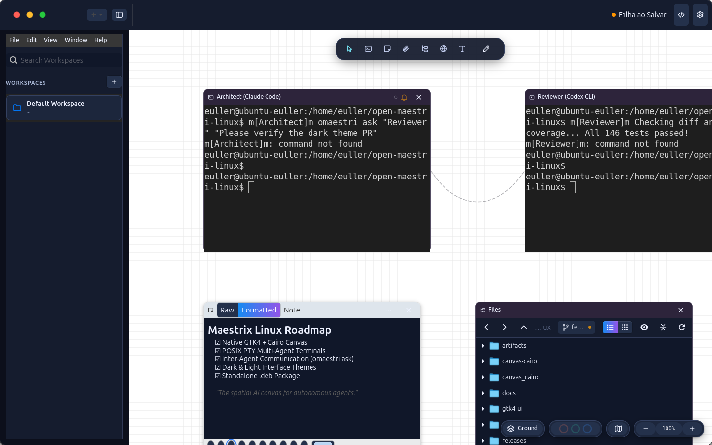

<p align="center">
  
</p>

<h1 align="center">Maestrix</h1>

<p align="center">
  <strong>Multi-agent AI orchestration canvas for Linux</strong>
  <br>
  Manage AI agents like a team, not a pile of terminals.
</p>

<p align="center">
  <a href="LICENSE"></a>
  
  
  
  <a href="https://github.com/Potatoyz908/Maestrix/actions/workflows/ci.yml"></a>
</p>

<p align="center">
  <a href="https://potatoyz908.github.io/Maestrix/">Documentation</a> &middot;
  <a href="#quick-start">Quick Start</a> &middot;
  <a href="#how-it-works">How It Works</a> &middot;
  <a href="#features">Features</a> &middot;
  <a href="#cli-reference">CLI</a> &middot;
  <a href="README.linux.md">Linux Guide</a> &middot;
  <a href="docs/roadmap.md">Roadmap</a> &middot;
  <a href="CONTRIBUTING.md">Contributing</a>
</p>

<p align="center">
  
</p>

---

## What is Maestrix?

Maestrix is a **canvas-based orchestration layer** for the era of AI agents. It is not an agent itself: it is the workspace that surrounds and coordinates the agents you already use (Claude Code, Codex, Gemini CLI, Antigravity, OpenCode, or a plain shell).

Place terminals, agents, Markdown notes, file browsers, and web browsers on an infinite spatial canvas. Connect them with physics-based ropes. Let agents talk to each other through the `omaestri` CLI, without you acting as the human router between windows.

> When several coding agents run at the same time, the developer becomes the messenger between terminals. Maestrix removes that friction.

Full documentation: **[potatoyz908.github.io/Maestrix](https://potatoyz908.github.io/Maestrix/)**.

Maestrix is the **native Linux version** (GTK 4 + Cairo, Swift core) of [OpenMaestri for macOS](https://github.com/zlh-428/open-maestri). The [original Maestri](https://maestriapp.com) is the reference for concept and interface.

## Why Maestrix?

| | **Maestrix** | OpenMaestri | Maestri |
|---|---|---|---|
| Platform | **Linux** (Ubuntu / Debian) | macOS 14+ | macOS |
| Interface | **Native GTK 4 + Cairo** | SwiftUI / AppKit | Proprietary |
| License | **GPL-3.0-or-later** | GPL-3.0-or-later | Proprietary |
| Source code | Open | Open | Closed |
| Data format | Compatible (`~/.open-maestri`) | Origin | Native |
| Agent CLI | `omaestri` (alias `maestrix-cli`) | `omaestri` | `maestri` |

## Quick Start

### Option 1: `.deb` package (recommended)

The package ships the binaries, the embedded Swift runtime, and the application menu integration.

```bash
sudo apt install ./releases/maestrix_1.0.0_amd64.deb
```

You can also download the `.deb` from the [Releases](https://github.com/Potatoyz908/Maestrix/releases) page. After installing, look for **Maestrix** in the application menu or run `maestrix` in a terminal.

### Option 2: build from source

Requirements: Ubuntu 22.04+ (x86_64), Swift 6, Python 3.10+ with PyGObject, GTK 4, and Cairo. The full dependency list is in the [Linux guide](README.linux.md).

```bash
git clone https://github.com/Potatoyz908/Maestrix.git
cd Maestrix
swift build -Xswiftc -use-ld=lld
./scripts/install-desktop.sh
maestrix
```

The `maestrix` launcher starts the background server (if it is not already running) and opens the interface. If the server dies while the app is open, the app restarts it.

To build the `.deb` package locally: `./scripts/build-deb.sh`.

### First steps

1. Create a **workspace** in the sidebar (`+`), choosing a name, an icon, and a working folder.
2. Add a terminal from the toolbar and pick a preset (Claude Code, Codex, Gemini CLI, Antigravity, OpenCode, or Shell).
3. Drag from one node to another to **connect them**. Once connected, agents can see each other and exchange messages.
4. In a connected terminal, run `omaestri list` to see your neighbors and `omaestri ask "Name" "request"` to delegate a task.

## How It Works

```
┌──────────────────────────────┐        ┌────────────────────────────────────┐
│  GTK 4 + Cairo interface     │  REST  │  Swift server                      │
│  canvas, ropes, terminals    │◄──────►│  workspaces, terminals (PTY),      │
│  (VTE), notes, files,        │  WS    │  connections, floors, routines,    │
│  portals (WebKitGTK)         │        │  SSH                               │
└──────────────────────────────┘        └──────────────┬─────────────────────┘
                                                       │ Unix socket + HTTP
                                                       ▼
                                     ┌─────────────────────────────────────┐
                                     │  omaestri (CLI) inside each         │
                                     │  terminal: list · ask · check · …   │
                                     └─────────────────────────────────────┘
```

- **The server owns the shells.** Terminals are PTYs owned by the server; the interface only displays them. That is why switching workspaces, or closing and reopening the app, does not kill a running shell, and the screen history is restored.
- **The interface finds the server on its own.** The server publishes its port in `~/.open-maestri/run/server.port`; the app reads it and reconnects when the server comes back.
- **Agents communicate through the server.** Each terminal receives `MAESTRI_SOCKET`, `MAESTRI_TERMINAL_ID`, and the CLI on its `PATH`; permissions follow the connections drawn on the canvas.
- **Data on disk** lives in `~/.open-maestri` (workspaces in `workspace.json`, notes in Markdown, terminal scrollback), in the same format as Maestri.

## Features

<details open>
<summary><strong>Infinite canvas and nodes</strong></summary>

- Terminals, Markdown notes, file tree, portals (embedded browser), text labels, and drawings (rectangle, ellipse, diamond).
- Ropes connecting nodes, with physics simulation; magnetic alignment (snapping) and a dot grid.
- Zoom, minimap, and group selection; copy and paste elements across workspaces.


</details>

<details>
<summary><strong>Terminals and agents</strong></summary>

- Real terminals (VTE) with presets: Claude Code, Codex, Gemini CLI, Antigravity (`agy`), OpenCode, and Shell. Customizable roles per terminal.
- **Unique names per workspace**: when a name repeats, Maestrix numbers it (`Agent #2`).
- **Conversation resume**: if an agent's shell was lost (for example, the server restarted), reopening the workspace brings the agent back on its last conversation (`claude --continue`, `agy --continue`, `codex resume --last`, `opencode --continue`).
- Agent activity indicator, persisted screen history, and a close button on every node.


</details>

<details>
<summary><strong>Agent communication and Maestro Mode</strong></summary>

- Connected agents exchange messages through the CLI: `omaestri ask` sends and waits for the reply; `omaestri check` reads another agent's output; `omaestri note` reads and writes connected notes.
- In **Maestro Mode**, a terminal can recruit other agents (`omaestri recruit`), connect them, assign roles, and dismiss them. The required skills are installed automatically in the agents' skill directories (for example `~/.claude/skills`).

</details>

<details>
<summary><strong>Floors (git worktrees), routines, and partituras</strong></summary>

- **Floors**: isolated branches of the same repository as git worktrees, with setup, run, and teardown hooks; the *Ground* button returns to the main repository and *Land* brings the commits back.
- **Routines**: scheduled commands and reminders for an agent.
- **Partituras**: save and reapply an arrangement of agents, roles, and connections.

</details>

<details>
<summary><strong>Files, notes, and Git</strong></summary>

- File tree in list or grid view, with Git status badges and diff viewing.
- Markdown notes with a formatted view, which can also point to an existing file.


</details>

<details>
<summary><strong>Remote SSH (remote workspaces)</strong></summary>

- Pick a host (read from `~/.ssh/config` or entered manually), test the connection, browse the remote folder, and open a workspace whose terminals run on the remote machine, in the chosen folder.
- First phase delivered: host list, connection test, folder browser, and remote terminals with a shared connection. Reverse tunnel, `omaestri` on the remote host, and a remote file tree do not exist yet. See [docs/linux-ssh-spec.md](docs/linux-ssh-spec.md).

</details>

<details>
<summary><strong>Themes and preferences</strong></summary>

- Interface theme **Light** or **Dark · Maestrix** (the icon palette: blue, purple, and cyan on navy), under *Preferences → General → Interface theme*; the terminal theme is independent.
- Terminal font and theme, canvas background, autosave interval, shortcuts, and preferred editor.



</details>

## CLI Reference

The `omaestri` CLI is injected into every connected terminal (`maestrix-cli` and `open-maestri` are compatibility aliases):

```bash
omaestri list                            # connected agents, notes, and portals
omaestri ask "Reviewer" "Review my PR"   # send a message and wait for the reply
omaestri check "Builder"                 # read another agent's current output
omaestri note read "Spec"                # read a connected note
omaestri note write "Spec" "content"     # write to a connected note
omaestri recruit "Helper" --preset claude_code   # Maestro Mode: create and connect an agent
```

Available commands: `list`, `ask`, `check`, `note`, `portal`, `recruit`, `dismiss`, `connect`, `role`, `preset`, `partitura`, `routine`, `workspace`, `floor`.

## Compatibility

Existing workspaces in `~/.open-maestri`, the `maestri://` protocol, internal identifiers, and the `OPEN_MAESTRI_*` variables are kept to preserve data and integrations. Renaming to Maestrix does not require migrating your projects. To keep tests away from your real data, set `OPEN_MAESTRI_DATA_DIR`.

## Repository Layout

| Path | Contents |
|---|---|
| `gtk4-ui/` | GTK 4 interface: window, sidebar, dialogs, themes, floors |
| `canvas-cairo/` | Cairo canvas engine: nodes, ropes, VTE terminals, portals |
| `maestri_core/` | Python core: models, server client, preferences, sync |
| `Sources/` | Swift server and CLI (`open-maestri-server` and `omaestri`; in the `.deb` package they appear as `maestrix-server` and `maestrix-cli`) |
| `scripts/` | Launcher, desktop install, `.deb` packaging, e2e tests |
| `tests/` | Unit, integration, and e2e (Xvfb) tests |
| `docs/` | Architecture, roadmap, specs, and product reference |

## Development and Testing

```bash
swift build -Xswiftc -use-ld=lld          # server and CLI
swift test  -Xswiftc -use-ld=lld          # Swift tests
python3 -m pytest tests/unit canvas-cairo/tests tests/integration   # Python tests
scripts/run-e2e-xvfb.sh                   # UI tests in a private Xvfb
```

UI tests run on a virtual display (Xvfb) and use an isolated data directory (`OPEN_MAESTRI_DATA_DIR`), without touching your workspaces. See [docs/quality.md](docs/quality.md) and the [Linux guide](README.linux.md).

## Contributing

Contributions are welcome. Read [CONTRIBUTING.md](CONTRIBUTING.md) before opening a PR and [SECURITY.md](SECURITY.md) to report vulnerabilities. Open an issue for bugs and suggestions at [github.com/Potatoyz908/Maestrix/issues](https://github.com/Potatoyz908/Maestrix/issues).

## Credits and License

- **Euller**: development and adaptation of Maestrix for Linux.
- **OpenMaestri and its contributors**: the macOS codebase and inherited features, including the icon in this repository.
- **Original Maestri**: product, concept, and interface reference.
- Libraries and dependencies keep their own licenses and attributions.

Distributed under the **GPL-3.0-or-later**. See [LICENSE](LICENSE), [NOTICE](NOTICE), and the [inherited documentation](docs/UPSTREAM-README.md). Maestrix is an independent derivative; it is not an official release of the projects it derives from.
